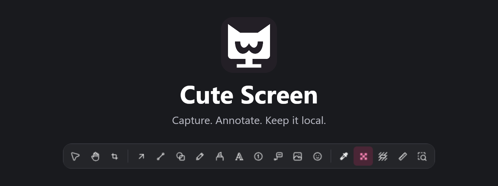
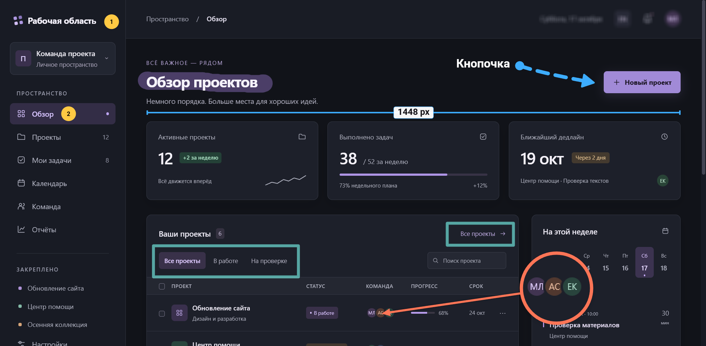

  <a href="README.md" lang="en">English</a> · <strong>Русский</strong> 
  <a href="https://vladimirivanin.github.io/cute-screen/">Сайт</a> ·
  <a href="#как-начать">Как начать</a> ·
  <a href="https://github.com/VladimirIvanin/cute-screen/issues">Сообщить о проблеме</a>

# Cute Screen

**Локальный редактор скриншотов с захватом экрана и аннотациями.** Сделайте снимок или откройте изображение, добавьте
наглядные пояснения и скопируйте либо сохраните результат. Снимки и редактируемые документы остаются на вашем устройстве.
Аккаунт не нужен.

Для сообщений об ошибках, инструкций, обсуждения дизайна и повседневных объяснений.

> **В разработке.** Редактор и сценарии захвата реализованы, но проверка платформ ещё продолжается.
> Опубликованных GitHub Releases и подписанных установщиков нет. Сейчас приложение можно запустить из исходников.

## Что можно сделать

| Задача                       | Инструменты                                                              |
| ---------------------------- | ------------------------------------------------------------------------ |
| Указать на деталь            | Стрелки, линии, фигуры, карандаш и выделитель                            |
| Объяснить последовательность | Текст, выноски и номерные метки                                          |
| Скрыть личные данные         | Ручная пикселизация или сплошное перекрытие                              |
| Показать мелкие детали       | Фонарь, лупа и линейка                                                   |
| Подготовить изображение      | Кадрирование, вставка дополнительных картинок и размещение аннотаций     |
| Продолжить работу            | Отмена и повтор действий, локальная история с редактируемыми аннотациями |
| Поделиться результатом       | Копирование готового изображения в буфер обмена или сохранение PNG       |

## Пример результата

Пример пояснений на снимке вымышленной админки. Откройте изображение, чтобы рассмотреть детали, или посмотрите
[инструменты на сайте](https://vladimirivanin.github.io/cute-screen/).

## Как начать

Сначала выполните [инструкцию запуска из исходников](docs/DEVELOPMENT.md#run-the-desktop-app). После запуска приложения:

1. **Снимите или откройте.** Выберите захват области, экрана или окна в меню трея либо назначьте сочетание клавиш.
   Также можно открыть изображение в редакторе. Доступные режимы захвата зависят от ОС.
2. **Добавьте пояснения.** На нижней панели выберите стрелки, подписи, номера и другие инструменты. Выделите объект,
   чтобы настроить его оформление. Отмена и повтор позволяют пересмотреть правки.
3. **Скопируйте или сохраните.** Отправьте готовое изображение в буфер обмена или сохраните PNG. Оригинальный снимок
   останется неизменным.

Захват области открывает Quick Capture: добавьте аннотации перед копированием или сохранением либо продолжите в полном
редакторе.

## Платформы и текущие ограничения

Cute Screen разрабатывается для **Linux, Windows и macOS**, с приоритетом Linux. Доступные режимы и фактическая проверка
отличаются между системами: успешная компиляция в CI не означает, что все возможности уже проверены.

| Платформа       | Особенности                                                                                                                                      |
| --------------- | ------------------------------------------------------------------------------------------------------------------------------------------------ |
| Linux / X11     | Нативный захват и глобальные сочетания; проверка зависит от композитора и конфигурации экранов.                                                  |
| Linux / Wayland | Системный выбор снимка через XDG portals. Сочетания используют GlobalShortcuts portal, если он доступен, иначе предлагается настройка через CLI. |
| Windows         | Нативный захват и глобальные сочетания. Для ARM64, нескольких мониторов и смешанного DPI ещё остаются непроверенные сценарии.                    |
| macOS           | Требуется разрешение на запись экрана. Проверка захвата и сочетаний на Intel и Apple Silicon продолжается.                                       |

Подтверждённые результаты и ограничения приведены в [матрице платформ](docs/PLATFORM_MATRIX.md).
Официального подписанного канала распространения и автоматической установки обновлений нет;
подробности — в [документации сборок](docs/BUILD_RELEASE.md).

## Помощь и обратная связь

[Создайте issue](https://github.com/VladimirIvanin/cute-screen/issues): укажите ОС, версию или commit приложения,
шаги воспроизведения и ожидаемый результат. Прикладывайте пример изображения, только если им безопасно делиться.

## Разработчикам

Установка окружения, команды, архитектура и обслуживание лендинга описаны в [руководстве разработчика](docs/DEVELOPMENT.md).
Подробные требования и доказательства — в [продуктовом контракте](docs/PRODUCT.md),
[архитектуре](docs/ARCHITECTURE.md) и [руководстве по проверкам](docs/TESTING.md).
